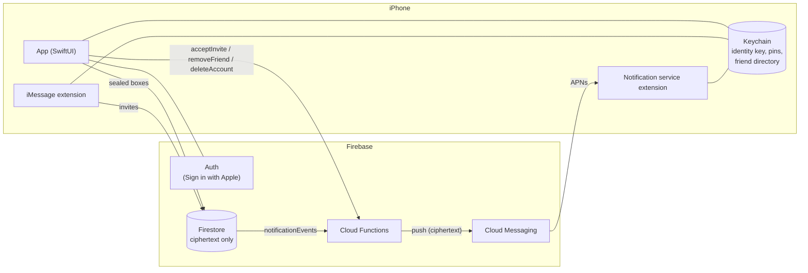

# Where Are You

An open-source iOS app for sharing your location with friends, in the spirit of Find My, with **end-to-end encryption**. Locations, names and alerts are encrypted on your iPhone and can only be read by the friends you choose. The backend (Firebase) only ever stores ciphertext.

Built with SwiftUI, Swift 6, CryptoKit and Firebase. iOS 18 or later, iPhone and iPad.

## Features

- **Live map of friends** with avatars, a People list, directions, and an address for each friend.
- **Share per friend.** Turn sharing on or off for each person, or pause everything with one switch. Your location is shared from one device at a time ("Use This iPhone as My Location").
- **Background sharing** through significant location changes and background refresh, so friends see you even when the app is closed.
- **Invites over iMessage.** An iMessage app sends an invite bubble that the other person accepts right inside Messages. Invite codes are the fallback.
- **Arrive and leave alerts.** "Tell me when Olivia gets home." The watched person's phone monitors the place, and they're always told when someone sets an alert on them.
- **Encrypted notifications.** A notification service extension decrypts alerts on your device.
- **Security codes and key change warnings**, like Signal's safety numbers.
- **Sign in with Apple**, plus full account deletion that also revokes the Apple token.

## How the encryption works

Each account has a Curve25519 identity key.
- **Storage.** The private key lives in the iOS Keychain. It syncs to your other devices through iCloud Keychain and is shared with the app's extensions. The public key is published to Firestore.

Everything private is sealed with **HPKE (RFC 9180) in auth mode** (X25519, HKDF-SHA256, ChaCha20-Poly1305):

- **Per-friend copies.** Profiles, locations, alert requests and alert events are encrypted separately for each recipient. Only that recipient can open their copy.
- **Sender authentication.** Auth mode proves which key sealed a box, so the server can't forge a location "from" your friend, even though it knows every public key.
- **Context binding.** Each box is bound to its payload type, sender, recipient and both key IDs. The server can't move a box to another document or present it as something else.
- **Padding.** Plaintext is padded to 64-byte blocks so ciphertext sizes don't reveal, for example, how long your name is.
- **Validation.** Decrypted content is validated, because it comes from someone else's device.

Key exchange happens through invites:

- **Checking the inviter's key.** An invite carries the inviter's key ID inside an iMessage, which Apple encrypts end to end. When accepting, the app checks that the key the server returns for the inviter matches that ID before it agrees to anything.
- **Pinning.** Each friend's key is pinned. If it changes later, you see a warning and can compare 60-digit security codes in person.

The code is in [`Packages/WhereAreYouKit/Sources/WAYCore`](Packages/WhereAreYouKit/Sources/WAYCore), starting with `Sealing.swift`.

### What the server can and can't see

| Can see | Can't see |
|---|---|
| Account IDs and public keys | Your name and avatar |
| Who is friends with whom | Any location |
| Whom you share your location with, and how often you upload | Place names, coordinates or radii of alerts |
| That someone set an alert on someone, and when one fired | Which place an alert is for, or whether it's "arrive" or "leave" |
| Device push tokens and your notification preferences | The text of your notifications |

### Limitations of this design

Read these before relying on the app for anything serious. This is a hobby project and hasn't had a security audit.

- **No forward secrecy.** Each account uses one long-lived key. If a private key leaks, anything the server stored for that person can be decrypted. Ciphertexts are replaced as locations update, but a server that kept copies could decrypt them later.
- **Key compromise impersonation.** Someone holding your private key can make messages that appear to come from your friends, sent to you.
- **The server is trusted for metadata.** See the table above. It could also replay an old (authentic) location. The app shows its real timestamp, and it can't be passed off as newer.
- **Trust on first use for the inviter.** The person accepting an invite checks the inviter's key against the invite. The inviter accepts the invitee's key on first sight. Compare security codes to close that gap.
- **Losing your key.** If iCloud Keychain is off and you lose all your devices, you'll need a new key. Friends re-encrypt for it automatically, but anything sealed to the old key can't be read.

## Architecture



| Path | What's there |
|---|---|
| `where-are-you/` | The app: map, people, invites, sharing, alerts, settings. |
| `WhereAreYouMessages/` | iMessage app extension: sends and accepts invite bubbles. |
| `WhereAreYouNotificationService/` | Decrypts alert pushes on the device. Links WAYCore only. |
| `Shared/` | Code compiled into both the app and the iMessage extension. |
| `Packages/WhereAreYouKit` | `WAYCore`: encryption, payloads, invites, sharing and alert logic. No Firebase, and fast `swift test` on a Mac. |
| `Packages/WhereAreYouFirebase` | `WAYFirebase`: the Firebase implementations of WAYCore's backend protocols. |
| `firebase/` | Firestore security rules, Cloud Functions (TypeScript) and their tests. |
| `Config/` | xcconfigs, entitlements and partial Info.plists. |

The Firestore data model and its access rules are documented in [`firebase/firestore.rules`](firebase/firestore.rules).

## Getting started

### Requirements

- **Xcode:** Xcode 16.3 or later. The project uses Swift 6 language mode and Xcode 16's synchronized folders, and was developed with a newer Xcode.
- **For the backend:** Node.js 22, the [Firebase CLI](https://firebase.google.com/docs/cli) (`npm install -g firebase-tools`), and Java 21 or later for the emulators.

### 1. Run it locally against the Firebase emulators

You don't need a Firebase project for this. A Debug build without a `GoogleService-Info.plist` talks to the local emulators automatically.

```sh
git clone https://github.com/ItsYaBoyJG/where-are-you.git
cd where-are-you

# Backend dependencies, and the functions build the emulator runs
(cd firebase && npm install)
(cd firebase/functions && npm install && npm run build)

# Start Auth, Firestore and Functions emulators (UI at http://localhost:4000)
cd firebase && firebase emulators:start
```

Then open `where-are-you.xcodeproj` and run the **where-are-you** scheme on a simulator.
- **Signing in:** tap **Sign In with Emulator Test Account**. Each name you type is a separate account.
- **Trying it with two people:** run two simulators side by side. Use the invite code under **Add Friend** to connect them; Messages isn't available in the simulator.
- **On a physical device:** set the `FIREBASE_EMULATOR_HOST` environment variable in the scheme to your Mac's address.

Push notifications don't work against the emulators: there's no APNs connection, so devices don't register. Alerts still fire, and the notification function still processes them; you can follow that in the Emulator UI's logs.

### 2. Signing

To run on a device, copy `Config/Local.xcconfig.example` to `Config/Local.xcconfig`. It's gitignored. Set:

```
DEVELOPMENT_TEAM = YOUR_TEAM_ID
BUNDLE_ID_PREFIX = com.yourname
```

Don't pick a team in Xcode's Signing tab: Xcode would write it into the tracked project file. With automatic signing, Xcode registers the App IDs and capabilities on its first device build: Sign in with Apple, Push Notifications, App Attest, and Keychain Sharing for the app and both extensions.

### 3. Connect your own Firebase project

1. **Create a project** in the [Firebase console](https://console.firebase.google.com) and upgrade it to the **Blaze** plan. Cloud Functions require it; the free allowance covers personal use.
2. **Add an iOS app** with your app's bundle ID (`$(BUNDLE_ID_PREFIX).where-are-you`). Download **GoogleService-Info.plist** into `where-are-you/`. It's gitignored, and the extensions read the app's copy.
3. **Authentication:** enable the **Apple** provider. To revoke Apple tokens when someone deletes their account (an App Store requirement), also fill in the Services ID, Apple Team ID, Key ID and private key under the provider's OAuth code flow settings.
4. **Firestore:** create a database in production mode. Then enable TTL policies, so expired invites and undelivered notification events are cleaned up:
   ```sh
   gcloud firestore fields ttls update expiresAt --collection-group=invites --enable-ttl
   gcloud firestore fields ttls update expiresAt --collection-group=notificationEvents --enable-ttl
   ```
5. **Cloud Messaging:** upload an APNs authentication key (`.p8`) from your Apple Developer account.
6. **App Check:** register the app and both extensions. Use App Attest, with DeviceCheck as a fallback for devices and extensions that don't support App Attest. Once it's working, enforce App Check for Firestore. The callable functions already require it outside the emulator.
7. **Deploy:**
   ```sh
   cd firebase
   firebase use --add            # pick your project
   firebase deploy --only firestore,functions
   ```

Release builds without `GoogleService-Info.plist` show a "Not Configured" screen instead of crashing. In Debug builds, set `USE_FIREBASE_EMULATOR=1` in the scheme to use the emulators even with the plist present.

## Testing

```sh
# Encryption, payloads, invites, sharing and alert logic, on the Mac (fast)
cd Packages/WhereAreYouKit && swift test

# App unit and UI tests. The app runs against in-memory fakes, so no backend is needed.
xcodebuild -project where-are-you.xcodeproj -scheme where-are-you \
  -destination 'platform=iOS Simulator,name=iPhone 16 Pro,OS=18.4' test

# Firestore rules and Cloud Functions, against the emulators
(cd firebase && npm test)
(cd firebase/functions && npm test)

# Cloud Functions helpers only, without emulators
(cd firebase/functions && npm run test:unit)
```

Pick a simulator you have installed (`xcrun simctl list devices available`), and always include `OS=` in the destination.

## Known limitations

- **Untested end to end.** Push delivery, background relaunches and region monitoring need a real Firebase project, an APNs key and a physical device. They aren't covered by the automated tests.
- **Background updates are best effort.** iOS decides when background refresh runs, and significant-change updates come about every 500 m. A stationary friend's "last updated" time can grow old.
- **Alert limits.** iOS watches at most 20 regions per app. Alert requests sync to the watched person's phone the next time the app runs, usually within minutes.
- **Friend limit.** At most 100 friends per person, because each location update is encrypted once per friend.
- **Push tokens.** Pushes use FCM registration tokens. Firebase 12 deprecates those in favour of an opt-in installation-ID model, and moving over is a follow-up.
- **Not built yet:** map clustering, photo avatars, translations (the string catalog is in place), and artwork for the app and iMessage icons.

## Contributing

See [CONTRIBUTING.md](CONTRIBUTING.md). Report security issues privately as described in [SECURITY.md](SECURITY.md).

## License

[MIT](LICENSE)
